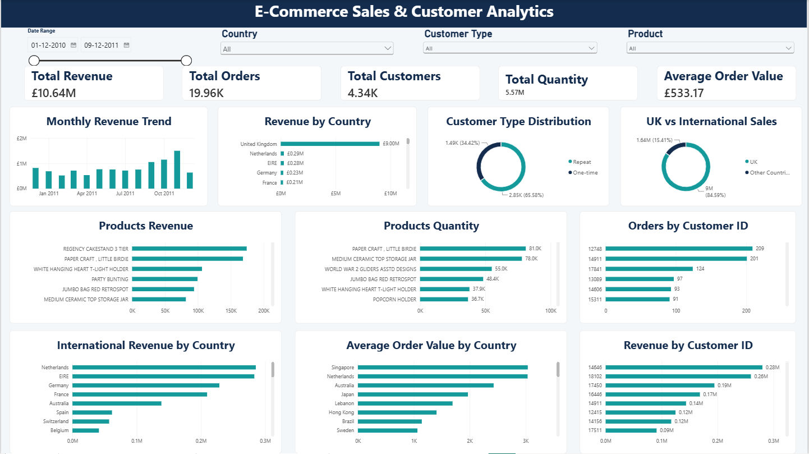

# E-Commerce Sales & Customer Analytics

## About the Project

I worked on this project to explore e-commerce sales data and understand how the business was performing. I wanted to look beyond total sales and find out which products performed well, how customers purchased, and which countries contributed the most revenue.

I used Python to clean and analyse the data, then built an interactive dashboard in Power BI to present the main findings.

## Tools I Used

- **Python** – Data cleaning and analysis
- **Pandas and NumPy** – Working with and transforming data
- **Exploratory Data Analysis (EDA)** – Finding patterns and trends in the data
- **Power BI** – Building the interactive dashboard 
- **DAX** – Creating measures and calculating key performance indicators (KPIs)

## Dataset

The project uses the [Online Retail dataset from the UCI Machine Learning Repository](https://archive.ics.uci.edu/dataset/352/online+retail). It contains transaction records from a UK-based online retailer covering December 2010 to December 2011.

## What I Did

1. Explored the dataset and checked its quality.
2. Handled missing values and removed duplicate records.
3. Filtered out cancelled transactions and records with invalid quantities or prices.
4. Created a revenue column and additional date-based features for analysis.
5. Analysed sales performance, product demand, customer purchasing behaviour, and country-wise revenue.
6. Built a Power BI dashboard with KPI cards, charts, and interactive filters to make the results easier to explore.

## Key Findings

- **Total revenue:** Approximately £10.64 million.
- **Total orders:** 19,960 distinct invoices after cleaning.
- **UK sales contribution:** The United Kingdom accounted for around 84.6% of total revenue.
- **Repeat customers:** Customers who made repeat purchases contributed around 93.1% of revenue from customers with an identified Customer ID.
- **Monthly performance:** November 2011 recorded the highest monthly revenue in the dataset.

## Dashboard

## Project Status

The data cleaning, analysis, and Power BI dashboard are complete.

## About Me

**Shankar Chaudhari**  
B.Sc. Computer Science Graduate | Aspiring Data Analyst
